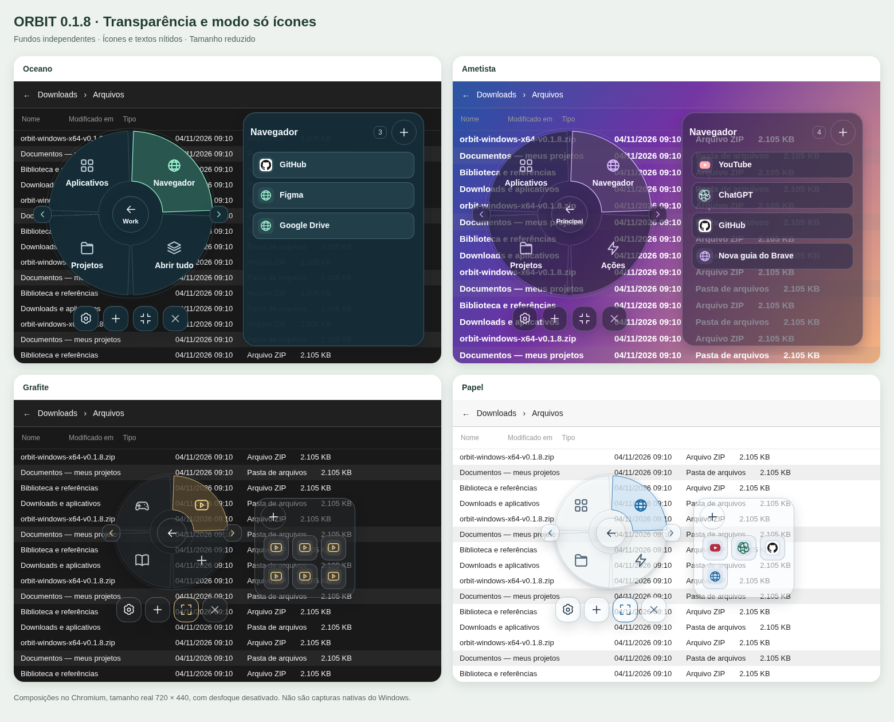

# ORBIT 0.1.8 — transparência por área e modo só ícones

Ajuste separadamente os fundos do círculo, da seleção, do painel lateral e dos aplicativos. O novo modo minimizado reduz o menu e mostra só ícones, com os nomes ao passar o mouse. Inclui Principal, Descanso, Work e os quatro temas.

[**Baixar para Windows x64**](https://github.com/miguelvianasecundario-netizen/lanchonete/raw/refs/heads/orbit-download-v0.1.0/downloads/orbit-windows-x64-v0.1.8.zip) · [**Baixar o código-fonte**](https://github.com/miguelvianasecundario-netizen/lanchonete/raw/refs/heads/orbit-download-v0.1.0/downloads/orbit-codigo-fonte-v0.1.8.zip)

## Abrir e atualizar

1. Encerre a versão anterior pela bandeja → **Encerrar Orbit**.
2. Extraia **todos os arquivos** do ZIP em uma pasta nova.
3. Abra `orbit.exe`, com `WebView2Loader.dll` ao lado dele.

Requer Windows 11 x64 e Microsoft Edge WebView2 Runtime. Alt + clique central é a ativação padrão; seu atalho salvo continua funcionando. A engrenagem permite escolher o atalho de teclado. Esc ou clique externo oculta o launcher.

## Transparência e modo minimizado

Abra **engrenagem → Transparência e tamanho**. Os quatro controles vão de **0% (sólido)** a **100% (sem fundo)** e são salvos automaticamente:

- **Menu circular:** fundo do círculo, centro e controles abaixo dele.
- **Setor selecionado:** fundo da categoria destacada, independente do restante do círculo.
- **Painel lateral:** fundo da lista de opções.
- **Botões dos apps:** fundo de cada cartão de aplicativo/atalho.

Os nomes, ícones e contornos mantêm sua intensidade. Quanto maior a transparência, mais o conteúdo atrás do menu aparece. O ajuste afeta os fundos do Orbit; não modifica a janela dos aplicativos abertos.

Ative **Modo minimizado — só ícones** nessa seção ou pelo botão de reduzir/expandir abaixo do círculo. No tamanho padrão de janela, a bola passa de **304 para 208 px**, e os atalhos aparecem em uma grade de botões de 44×44 px. Passe o mouse para ler os nomes. Teclado, paginação, cadastro e abertura continuam disponíveis. Configurações e resultados do Work mantêm seus textos.

**Restaurar transparência e tamanho** retorna ao modo com nomes e aos valores padrão: círculo 0%, seleção 0%, painel 4% e apps 0%. A atualização preenche esses valores automaticamente em preferências antigas.

## Seus três menus

As setas laterais alternam **Principal → Descanso → Work**. A seta anterior faz o caminho inverso. O último modo fica salvo.

- **Principal:** Aplicativos, Navegador, Projetos e Ações.
- **Descanso:** Jogos, Streaming e suas opções. Os seis serviços de streaming anteriores foram preservados.
- **Work:** Aplicativos, Navegador, Projetos e **Abrir tudo**. Começa vazio para você escolher o que deseja iniciar junto.

O **+ abaixo da bola** adiciona uma opção diretamente nela. O **+ no cabeçalho da categoria** adiciona àquela lista. No formulário, escolha a bola, a categoria e o tipo: site HTTPS, pasta ou executável `.exe`. Qualquer categoria aceita os três tipos. Mais de quatro opções na bola aparecem em páginas; as setas abaixo da bola mudam a página.

O ícone do site é buscado automaticamente no próprio site; o de um executável ou pasta é extraído pelo Windows. A imagem aparece quando termina de carregar, com um símbolo de reserva se estiver indisponível. O cache local dura 24 horas. Não é necessário escolher uma imagem manualmente.

Para remover, use a lixeira na lista de atalhos das configurações. Isso remove apenas o atalho do Orbit.

## Abrir o Work

**Abrir tudo** inicia somente os atalhos cadastrados no Work, inclusive os que estão diretamente na bola. Mostra um resultado por item: **Aberto**, **Já estava aberto** ou **Não abriu**, com o motivo da falha. Cliques repetidos durante a operação não iniciam outro lote.

- **Sites:** a extensão verifica as abas abertas e as navegações pendentes no perfil conectado do Brave. Só cria URLs ausentes, em segundo plano, sem selecionar abas existentes. URLs iguais dentro do próprio lote também não se repetem. Caminho, parâmetros e fragmento fazem parte da comparação: duas páginas diferentes do mesmo site continuam sendo dois atalhos.
- **Aplicativos:** solicita abertura minimizada, sem ativar a janela. Se o mesmo executável já estiver rodando, mantém a instância existente. Acompanha por quatro segundos as novas janelas dos executáveis solicitados para minimizar aquelas que ignorarem a instrução inicial.
- **Pastas:** solicita abertura minimizada ao Explorador. Pastas repetidas no mesmo lote são solicitadas apenas uma vez.

Um clique individual em um atalho do Work também usa essas regras. Principal e Descanso continuam com abertura normal.

**Alguns programas, jogos, iniciadores e o Explorador podem ignorar a solicitação de minimizar; prompts de administrador também podem aparecer.** Não há garantia de impedir toda tomada de foco por terceiros. A execução real dessa versão ainda precisa ser conferida no Windows.

## Conectar o Brave uma vez

1. No Orbit, abra **engrenagem → Brave no Work → Preparar extensão**. O Orbit prepara a integração local e abre a pasta da extensão.
2. No Brave, entre em `brave://extensions`, ative **Modo de desenvolvedor** e clique em **Carregar sem compactação**.
3. Selecione a pasta aberta pelo Orbit: `%LOCALAPPDATA%\app.orbit.launcher\browser-extension`.
4. Confira **Brave conectado** nas configurações. Se necessário, abra o ícone da extensão e clique em **Reconectar**.

Instale no perfil que você usa para trabalhar. A conexão atende **um perfil por vez** e só verifica as abas acessíveis à extensão nesse perfil. Se trocar de perfil, desconecte/desative a extensão no anterior e reconecte no desejado.

Se o Brave estiver fechado, o Orbit tenta iniciá-lo minimizado nas pastas padrão de instalação. Sem a extensão conectada, informa a falha dos sites e continua os outros atalhos; não abre sites às cegas, evitando duplicações. Se o navegador demorar a iniciar, aguarde a conexão e tente novamente.

A extensão solicita acesso às abas, comunicação nativa e alarmes de reconexão. Não guarda histórico de navegação. A comunicação com o Orbit ocorre em localhost com um token renovado a cada execução. [Guia da extensão e solução de problemas](browser-extension/README.md).

## Aparência e dados

Temas **Oceano, Ametista, Grafite e Papel**, com leitura protegida sobre fundos claros e escuros. Janela padrão de 720×440 unidades lógicas; bola de 304 px. Em áreas menores, bola e lista usam a mesma área em etapas; em alturas muito baixas, os setores viram uma grade. Nomes longos ficam em duas linhas, com nome completo no tooltip.

Atalhos, histórico e preferências continuam em `%LOCALAPPDATA%\app.orbit.launcher\orbit.sqlite3`. Não houve migração destrutiva. Limite de 100 atalhos personalizados. Pastas e `.exe` são validados novamente ao abrir; executáveis não recebem argumentos livres ou comandos de shell. Links personalizados exigem HTTPS sem credenciais.

Na prévia web, temas e cadastro de URLs funcionam. Ícones nativos, seletores, ações Windows e a abertura do Work precisam da versão desktop.



## Testes e desenvolvimento

Resultados e limites estão em [VALIDACAO.md](VALIDACAO.md). O executável foi compilado em Linux para Windows; não foi executado no Windows nesta rodada. O Chromium gerenciado bloqueou a instalação da extensão, portanto a conexão completa com o Brave real permanece pendente. A lógica da extensão, o host Rust e a fronteira da interface foram testados separadamente. Nesta versão passaram 80 testes da interface, 33 Rust e 5 da extensão; os detalhes estão no relatório.

No Windows: Node 22.12+ ou 24, Rust MSVC, Visual Studio Build Tools C++, Windows SDK e WebView2.

```powershell
npm.cmd ci
npm.cmd run tauri -- dev
npm.cmd test
npm.cmd run test:extension
npm.cmd run build
cargo test --lib --manifest-path src-tauri/Cargo.toml --locked
cargo clippy --lib --manifest-path src-tauri/Cargo.toml --locked -- -D warnings
npm.cmd run tauri -- build
```

No Linux, `PLAYWRIGHT_CHROMIUM_EXECUTABLE_PATH` permite usar um Chromium instalado. Os testes do núcleo rodam com `cargo test --lib --manifest-path src-tauri/Cargo.toml --locked`. Após `cargo build --bin orbit --manifest-path src-tauri/Cargo.toml --locked`, `node tools/check-native-host.mjs` verifica o host Rust real com pipes binários e localhost. `node tools/visual-preview.mjs` gera a composição e verifica contraste sem desfoque.

Este ZIP é portátil e não possui assinatura digital. Instalador NSIS não foi gerado nesta entrega. Base do projeto: fonte 0.1.5 enviada pelo usuário, correções 0.1.6 e Work 0.1.7; o histórico de validação foi preservado em `docs/`.
