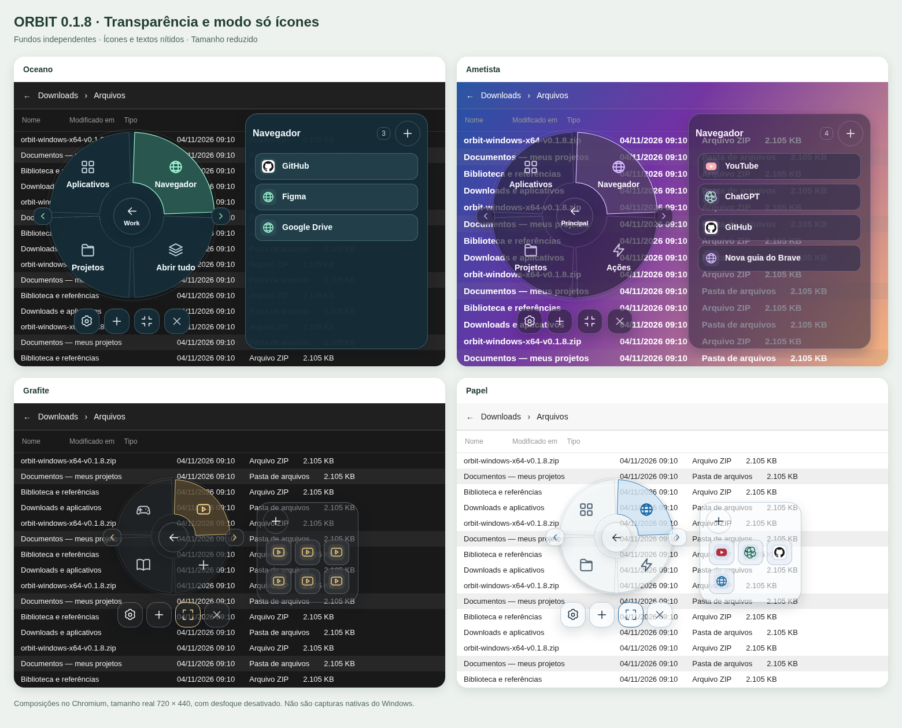

# ORBIT 0.1.8 — Transparência e modo só ícones

[**Baixar para Windows x64**](https://github.com/miguelvianasecundario-netizen/lanchonete/raw/refs/heads/orbit-download-v0.1.0/downloads/orbit-windows-x64-v0.1.8.zip) · [**Baixar o código-fonte**](https://github.com/miguelvianasecundario-netizen/lanchonete/raw/refs/heads/orbit-download-v0.1.0/downloads/orbit-codigo-fonte-v0.1.8.zip)

- Quatro controles de transparência independentes: círculo, seleção, painel lateral e botões dos apps.
- **Modo minimizado — só ícones**, com círculo menor, atalhos em grade e nomes ao passar o mouse.
- Ajustes em **engrenagem → Transparência e tamanho**; botão rápido de reduzir/expandir abaixo do círculo.
- Menu **Work**, com **Abrir tudo** e resultado por atalho.
- Adicione links, pastas e executáveis em qualquer menu/categoria. Ícones obtidos automaticamente.
- Integração com Brave para reconhecer URLs já abertas no perfil conectado e abrir somente as ausentes em segundo plano.
- Solicita apps minimizados, preserva os que já estão rodando e mantém Principal/Descanso, temas e dados anteriores.

1. Encerre o Orbit anterior pela bandeja.
2. Extraia todos os arquivos e abra `orbit.exe`, com `WebView2Loader.dll` junto dele.
3. Para os sites do Work: **engrenagem → Preparar extensão do Brave**, depois `brave://extensions` → Modo de desenvolvedor → Carregar sem compactação. Selecione a pasta aberta pelo Orbit.

[Guia da extensão](../browser-extension/README.md) · [Relatório dos testes](../VALIDACAO.md)

Passaram 80 testes de interface, 33 testes Rust e 5 testes da extensão, além do build e Clippy. Os ajustes são aplicados aos fundos; ícones e textos mantêm a opacidade. O executável foi compilado em Linux; conexão completa com Brave real, ícones nativos e minimização/foco ainda precisam de validação no Windows. Alguns programas podem ignorar a solicitação de minimizar.

Requer Windows 11 x64 e WebView2. Pacote portátil sem assinatura digital.

SHA-256 do aplicativo: `187532174c2892986b7cf2cc15a9fdbf5991bfe4b0e0c189facac18449369814`. [Checksum do código-fonte](orbit-codigo-fonte-v0.1.8.sha256).

Fonte: `ccd509c3829f550f951a9f31c2abb7c3f19eb88b`. [Versão anterior 0.1.7](orbit-windows-x64-v0.1.7.zip).
